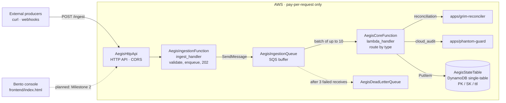

<div align="center">

# 🛡️ AegisSkeleton

**A zero-idle-cost serverless core, guarded by an AST pre-commit hook that rejects counterfeit persistence and unauthorized network egress.**

[](https://github.com/kenzikenzili-build/aegis-skeleton)
[](#the-two-derived-apps-skeleton-crew)

[](template.yaml)
[](template.yaml)
[](template.yaml)
[](.kiro/)
[](#zero-idle-finops)
[](LICENSE)

[**Live console**](http://aegis-skeleton-ui-1793421864.s3-website-us-east-1.amazonaws.com) ·
[**Architecture contract**](.kiro/steering/architecture.md) ·
[**Infrastructure (`template.yaml`)**](template.yaml) ·
[**AST Smite Guard**](.kiro/hooks/pre-commit) ·
[**Milestones**](docs/MILESTONES.md)

</div>

---

## Table of contents

1. [The problem: three phantoms](#the-problem-three-phantoms)
2. [The solution in one page](#the-solution-in-one-page)
3. [Architecture](#architecture)
4. [Zero-Idle FinOps](#zero-idle-finops)
5. [AST Smite Guard](#ast-smite-guard)
6. [Decimal integrity](#decimal-integrity)
7. [The two derived apps (Skeleton Crew)](#the-two-derived-apps-skeleton-crew)
8. [How Kiro governs this repo](#how-kiro-governs-this-repo)
9. [Getting started](#getting-started)
10. [Repository layout](#repository-layout)
11. [Status and known gaps](#status-and-known-gaps)
12. [License](#license)

---

## The problem: three phantoms

AI coding agents are fast, and they tend to leave the same three defects behind. Each one passes a demo and fails in production.

| Phantom | What the agent produces | What goes wrong |
| --- | --- | --- |
| **The Mirage UI** | A polished Tailwind/React interface wired to nothing real | It collapses once it meets an asynchronous backend |
| **The Lazy Storage** | `localStorage`, `sessionStorage`, or a module-level `ledger = []` standing in for a database | State disappears on reload or cold start, and integration bugs stay hidden |
| **The Billing Black Hole** | Recursive agent loops, always-on instances, unbuffered Lambda fan-out | A cloud bill nobody budgeted for |

AegisSkeleton does not ask the agent to behave. It makes the repository **mechanically refuse** these patterns, and it builds the backend so that idle time costs nothing.

## The solution in one page

AegisSkeleton is a deliberately small ("skeleton") core that other applications inherit. It has four binding rules, defined in [`.kiro/steering/architecture.md`](.kiro/steering/architecture.md):

| # | Rule | Enforced by |
| --- | --- | --- |
| 1 | **Zero-Mock.** No browser storage, no in-memory arrays or dicts posing as a database. DynamoDB is the only system of record. | AST Smite Guard (`.kiro/hooks/pre-commit`) |
| 2 | **Single-Table DynamoDB.** One table, one `PK`/`SK` pair, one `ttl` attribute, and a TTL on every item. | `template.yaml`, core handler, review checklist |
| 3 | **Zero-Idle serverless.** Graviton Lambda, SQS buffer, on-demand DynamoDB. No EC2, RDS, NAT gateway, or provisioned capacity. | `template.yaml`, `mcp/finops_sentry.py` |
| 4 | **`decimal.Decimal` for money.** Binary floats never touch a monetary value. | AST Smite Guard (`AEGIS-FLOAT`), core handler (`_money_text`), deterministic fixtures with a drift canary |

The architecture document is also a contract. If it disagrees with `template.yaml`, the template wins and the document is amended in the same commit.

---

## Architecture



> The dashed line from the console to the API is **not wired yet**. The console currently renders from loaded files and embedded fixtures and makes no network calls. See [Status and known gaps](#status-and-known-gaps).

### Components

All names below come from [`template.yaml`](template.yaml).

| Resource | Type | Role |
| --- | --- | --- |
| `AegisHttpApi` | HTTP API (API Gateway v2), `$default` stage | Only public entry point. CORS allows `POST` and `OPTIONS` with a `Content-Type` header. |
| `AegisIngestionFunction` | Lambda, `src.functions.app.ingest_handler` | Validates the request envelope, enqueues it, returns `202`. Does no business logic. |
| `AegisIngestionQueue` | SQS | Absorbs traffic spikes. `VisibilityTimeout: 30`, retention 4 days, redrive after `maxReceiveCount: 3`. |
| `AegisDeadLetterQueue` | SQS | Holds messages that failed three times, so poison messages are kept instead of silently dropped. |
| `AegisCoreFunction` | Lambda, `src.functions.app.lambda_handler` | SQS consumer (`BatchSize: 10`). Routes by `type` and writes to DynamoDB. |
| `AegisStateTable` | DynamoDB, `PAY_PER_REQUEST` | `PK` (S, HASH), `SK` (S, RANGE), TTL on `ttl`. The only persistence layer. |

Shared function settings (`Globals.Function`): `python3.12`, `arm64`, 256 MB, 10 s timeout. Both functions use `CodeUri: .`, so the repository root is the package and `apps/` ships with the code that routes to it. `sam build` copies non-hidden files, which also puts `tests/`, `docs/`, `frontend/` and `fixtures/` in the zip (about 276 KB unzipped).

### Request lifecycle

1. A producer sends `POST /ingest` with an envelope: `{"id": "...", "type": "...", "payload": {...}}`.
2. `ingest_handler` validates it and sends it to `AegisIngestionQueue` with a `type` message attribute.
3. SQS invokes `AegisCoreFunction` with up to 10 messages.
4. The core routes each message by `type` and writes one item to `AegisStateTable`. Writes are idempotent `PutItem` calls on deterministic keys, so a retry replaces a row instead of duplicating it.
5. If a record raises, the batch is retried. After three receives the message moves to the dead-letter queue.

**HTTP contract for `POST /ingest`**

| Status | Meaning |
| --- | --- |
| `202` `{"status":"QUEUED","message_id":"…"}` | Accepted into the buffer |
| `400` | Body is not valid JSON, is not an object, or lacks `id`, `type`, or `payload` |
| `500` | `INGESTION_QUEUE_URL` is not configured |
| `503` | SQS rejected the message. The caller should retry. |

**Routing and key space**

| Envelope `type` | Handler | `PK` | `SK` | TTL |
| --- | --- | --- | --- | --- |
| `reconciliation` | `apps/grim-reconciler` | `RECONCILE#LEDGER` | `TX#<transaction_id>` | 7 days (604,800 s) |
| `cloud_audit` | `apps/phantom-guard` | `GUARD#SECURITY_AUDIT` | `RESOURCE#<resource_id>` | 24 hours (86,400 s) |
| anything else | generic event | `TENANT#SYSTEM` | `EVENT#<type>#<id>` | 24 hours (86,400 s) |

`ttl` is an integer epoch-seconds value written on every item, so no row can sit in storage indefinitely. DynamoDB deletes expired items asynchronously, typically within hours, so readers should not assume an expired item is already gone.

---

## Zero-Idle FinOps

> **Rule 3:** Idle must cost exactly zero. Compute exists only while an event is being processed, and it dies immediately afterward.

Nothing in the stack is provisioned. Every component bills per request or per millisecond of actual work.

| Layer | Billing model | Why nothing bills while idle |
| --- | --- | --- |
| API | HTTP API, per request | No instance, no always-on gateway |
| Compute | Lambda on `arm64` Graviton, per request and per GB-second | No provisioned concurrency, no reserved warm pool |
| Buffer | SQS, per request | A queue is not a running process |
| State | DynamoDB `PAY_PER_REQUEST` | No read or write capacity units to pay for |
| Cleanup | DynamoDB TTL | Cold data is reclaimed at no cost, so storage cannot grow without bound |

**Forbidden in this repo:** EC2 instances, RDS instances, ECS services with a nonzero desired count, NAT gateways, idle load balancers, unattached EBS volumes, provisioned Lambda concurrency, and provisioned DynamoDB capacity. The MCP server `verify_compliance` tool rejects `AWS::EC2::Instance` and `AWS::RDS::DBInstance` in `template.yaml`. The architecture document lists the rest as review criteria.

> **One caveat on "zero".** Lambda's SQS poller issues `ReceiveMessage` calls even when the queue is empty, and [AWS documents these empty receives as billable SQS requests](https://aws.amazon.com/premiumsupport/knowledge-center/sqs-high-charges/). That is a per-request fee, not provisioned capacity, but it is the one line item that is not strictly zero at idle. CloudWatch Logs storage is also outside the template.

### Unit cost

This is a **modeled estimate, not a bill**. It uses us-east-1 list prices and the assumptions below, and it ignores the free tier.

| Assumption | Value |
| --- | --- |
| Batch size | 10 messages per core invocation |
| Ingest function | 50 ms at 256 MB per request |
| Core function | 300 ms at 256 MB per 10-message batch |
| Item size | At most 1 KB, so 1 write unit per `PutItem` |
| Writes per domain event | 2 (the domain app writes, then the core writes the canonical item to the same key) |

| Component | List price used | Cost per 10,000 events |
| --- | --- | --- |
| HTTP API requests | $1.00 per million | $0.0100 |
| SQS (1 send + batched receive and delete) | $0.40 per million | $0.0048 |
| Ingest Lambda (arm64) | $0.20 per million requests + $0.0000133334 per GB-s | $0.0037 |
| Core Lambda (arm64) | same | $0.0012 |
| DynamoDB writes | $0.625 per million write units | $0.0125 |
| **Total** | | **≈ $0.032** (about $3.20 per million events) |

The ingest function alone costs about $0.004 per 10,000 invocations, which matches the figure reported by `get_finops_guardrail_status` in [`mcp/finops_sentry.py`](mcp/finops_sentry.py). Re-check the rates against the current pricing pages before quoting them: [Lambda](https://aws.amazon.com/lambda/pricing), [API Gateway](https://aws.amazon.com/api-gateway/pricing/), [SQS](https://aws.amazon.com/sqs/pricing/), [DynamoDB on-demand](https://aws.amazon.com/dynamodb/pricing/on-demand/).

### A regression input for waste

[`fixtures/tfplan.json`](fixtures/tfplan.json) is a Terraform plan that deliberately contains an **unattached 100 GB `gp3` volume** and an **idle Lambda provisioned-concurrency config**. The console's Zombie `tfplan.json` loader flags both and prints an estimated hourly burn. A plan that reports resources like these is meant to fail the cost gate.

---

## AST Smite Guard

[`.kiro/hooks/pre-commit`](.kiro/hooks/pre-commit) is a standard-library-only Python script (`AegisASTSmiteGuard`). It parses each staged Python file with `ast` and exits `1` on any violation, which blocks the commit. **There is no waiver flag. Fix the code.**

Text matching is easy to fool with an alias or a rename. Parsing the syntax tree lets the guard follow imports, aliases, and mutations.

### What it blocks

| Rule | Detects | Examples |
| --- | --- | --- |
| `AEGIS-EGRESS` | Imports and calls of network modules: `requests`, `urllib`, `urllib3`, `httpx`, `aiohttp`, `http.client`, `ftplib`, `telnetlib`, `smtplib`, `xmlrpc`. This includes aliases and dynamic imports. | `import requests as r; r.get(...)`, `importlib.import_module("requests")` |
| `AEGIS-EGRESS` | Raw socket egress | `socket.socket`, `socket.create_connection`, `socket.socketpair`, `socket.create_server` |
| `AEGIS-STATE` | A **store-shaped** container that is created as a list, dict, or set and then mutated (`.append`, `.update`, `[k] = v`, `del`, `.pop`, and similar) | `ledger_db = []` then `ledger_db.append(tx)`, `self._store = {}` then `self._store[k] = v` |
| `AEGIS-STATE` | Mock-shaped persistence classes and factories | `class InMemoryDatabase`, `class MockTable`, `build_mock_store()` |
| `AEGIS-FLOAT` | Float arithmetic on a monetary field: `+ - * /` (and `+=`, `*=` and similar) where a name containing `amount`, `balance`, `cost`, `fee` or `price` meets a float literal or a `float()` call, including float math assigned into such a name | `fee = amount * 0.029`, `total = float(price) + 1`, `fee = gross * 0.029 + 0.30` |
| `AEGIS-WEB-STORAGE` | Browser persistence in `.js`, `.ts`, `.html`, `.vue`, and similar files | `localStorage`, `sessionStorage`, `indexedDB` |
| `AEGIS-SYNTAX` | Python that cannot be parsed, so no file escapes the scan by being broken | |

`boto3` and `botocore` are the one authorized egress path. Their traffic is IAM-signed and goes to AWS services only.

### What a block looks like

```text
❌ [聖騎士淨化攔截] 檢測到 3 項架構違規，提交已被阻擋。

  ✗ billing_service.py:1  [AEGIS-EGRESS | 未授權網路出口]
      偵測: unauthorized network module import: 'requests'
  ✗ billing_service.py:6  [AEGIS-STATE | 虛假持久化層]
      偵測: in-memory store 'ledger_db' mutated via .append() - counterfeit database
      原始碼: ledger_db.append(tx)
  ✗ billing_service.py:7  [AEGIS-EGRESS | 未授權網路出口]
      偵測: unauthorized network egress call: requests.post(...)
```

On this commit the guard scans the whole repository clean (7 Python files, 1 web asset, 0 violations). Its own tests are in [`tests/test_ast_float_guard.py`](tests/test_ast_float_guard.py).

### Scope and limits

The guard is a strong filter, not a proof, and the README should say so:

- **State detection is name-based.** A container is flagged when its identifier looks like a store (`db`, `store`, `cache`, `ledger`, `registry`, `records`, `queue`, `table`, `session`, `buffer`, and similar). `rows = []; rows.append(1)` is not flagged.
- **The float rule is syntactic.** It does not infer types, so a float held in a plain variable (`rate = 0.029; fee = gross * rate`) is not seen. It also does not flag a bare literal (`price = 19.99`), `round(amount, 2)` on its own, epsilon comparisons, or `Decimal(0.1)` built from a float. Those stay review items. See [Decimal integrity](#decimal-integrity).
- **It is opt-in per clone.** Git hooks are not versioned, so each contributor installs it once (see [Getting started](#getting-started)).

---

## Decimal integrity

Binary floats cannot represent base-10 cents:

```python
>>> 400.19 - 400.17
0.01999999999998181      # not 0.02: a phantom variance
```

A reconciler that uses floats can invent a discrepancy that does not exist, or hide a real one inside the noise. The core handler therefore passes every monetary field through one function before it reaches DynamoDB:

```python
amount = Decimal(str(value))                      # never via float
text   = str(amount.quantize(CENT, rounding=ROUND_HALF_UP))   # stored as a string
```

The Smite Guard rejects float arithmetic on monetary names at commit time, and this function is the runtime backstop. It rejects booleans, non-numeric values, and non-finite values. Amounts are persisted as `str(Decimal)`, never as a number type that could round-trip through a float.

**The row-42 canary.** [`scripts/generate_fixtures.py`](scripts/generate_fixtures.py) writes 100 Stripe settlement rows and 100 matching ledger rows, with a deterministic `-0.02` drift on ledger row index 42. Comparing the two files with `Decimal` yields exactly one non-zero variance, `Decimal('-0.02')`, at row 42, and no noise on the other 99 rows. The generator is stdlib-only, uses no network or PRNG, and regenerates byte-identical files.

---

## The two derived apps (Skeleton Crew)

The Skeleton Crew category asks for a lean core plus distinct applications built on it. Both apps below inherit the same queue, table, key conventions, and guard. Each has its own spec in [`.kiro/specs/`](.kiro/specs/).

### `apps/grim-reconciler` · FinTech reconciliation

| | |
| --- | --- |
| **Event type** | `reconciliation` |
| **Does** | Takes a transaction event, maps its status to `SETTLED` or `FLAGGED_DISCREPANCY`, and records the result. The core handler then normalizes the amount with `Decimal`. |
| **Key** | `PK = RECONCILE#LEDGER`, `SK = TX#<transaction_id>` |
| **TTL** | 7 days |
| **Spec** | [`grim_reconciler.spec.json`](.kiro/specs/grim_reconciler.spec.json): event schema, state machine, DynamoDB mapping (intent in [`grim-reconciler.spec.json`](.kiro/specs/grim-reconciler.spec.json)) |

### `apps/phantom-guard` · DevOps and FinOps cloud sentry

| | |
| --- | --- |
| **Event type** | `cloud_audit` |
| **Does** | Takes a cloud resource event and records its type and estimated hourly burn. Resources of type `AWS::EC2::Instance` or `AWS::RDS::DBInstance` are recorded with `circuit_breaker_triggered: true`. |
| **Key** | `PK = GUARD#SECURITY_AUDIT`, `SK = RESOURCE#<resource_id>` |
| **TTL** | 24 hours |
| **Spec** | [`phantom_guard.spec.json`](.kiro/specs/phantom_guard.spec.json): event schema, discovery rules, TTL eviction (intent in [`phantom-guard.spec.json`](.kiro/specs/phantom-guard.spec.json)) |

A third path exists for everything else: unknown `type` values land under `TENANT#SYSTEM` with a 24-hour TTL, so the skeleton accepts new event types without code changes.

### The console

[`frontend/index.html`](frontend/index.html) is a single static file: a bento-style telemetry console with an ingest zone, a ledger pipeline table, and Zero-Idle FinOps, Kiro Governance, and Reconciliation Manifest cards. It loads the Stripe/ledger fixtures or the zombie `tfplan.json`, computes variance in integer cents, flags the unattached `gp3` volume and the idle provisioned concurrency, and shows the estimated steady-state burn. Rows render only from ingested artifacts. It uses no browser storage, and the guard scans it.

---

## How Kiro governs this repo

Kiro is used as the governance layer, not only as an editor. Everything the project promises is written down in `.kiro/` and then checked by something other than the author.

```text
.kiro/
├── steering/architecture.md           # the binding contract: 4 rules, key tables, delivery gate
├── specs/core-architecture.spec.json  # core intent: buffer everything, no EC2, TTL on all state
├── specs/grim-reconciler.spec.json    # per-app intent, inherits the core
├── specs/phantom-guard.spec.json
├── specs/grim_reconciler.spec.json    # formal contract: JSON Schema, state machine, table mapping
├── specs/phantom_guard.spec.json      # formal contract: JSON Schema, discovery rules, TTL eviction
├── hooks/pre-commit                   # AegisASTSmiteGuard: mechanical enforcement
└── mcp.json                           # registers the finops-sentry MCP server
```

- **Steering is the contract.** [`architecture.md`](.kiro/steering/architecture.md) states each rule, the reason for it, the allowed key conventions, and how it is enforced. It names `template.yaml` as the source of truth.
- **Specs capture intent per app.** A new derived app starts from the core spec and adds its own rules.
- **A rule that the hook does not enforce is advisory.** The steering file says so, and it is why Rule 1 is a script and not a paragraph.
- **Amendments are atomic.** A rule change must update the spec, the steering file, `template.yaml` (if infrastructure changes), the hook, and the fixture generator in one commit.
- **An MCP server gives the agent a live audit tool.** [`mcp/finops_sentry.py`](mcp/finops_sentry.py) is a stdio JSON-RPC server with two tools: `get_finops_guardrail_status` and `verify_compliance`. Kiro can ask whether the template still complies before it proposes a change.

**Delivery gate.** A change merges only when:

1. `python3 .kiro/hooks/pre-commit` exits `0`.
2. `python3 scripts/generate_fixtures.py` regenerates byte-identical fixtures.
3. `template.yaml` still declares exactly one DynamoDB table with `PK`/`SK`, an enabled `ttl`, and `PAY_PER_REQUEST`, with `arm64` functions.
4. No monetary value is derived through `float`.

---

## Getting started

### Prerequisites

- Python 3.11 or newer for the local tooling (the Lambda runtime is 3.12)
- [AWS SAM CLI](https://docs.aws.amazon.com/serverless-application-model/latest/developerguide/install-sam-cli.html) and AWS credentials, for deployment only

The hook, fixture generator, and MCP server use only the standard library. The Lambda package has no third-party dependencies, because `boto3` is provided by the runtime.

### Local development

```bash
git clone -b dev https://github.com/kenzikenzili-build/aegis-skeleton.git
cd aegis-skeleton

# 1. Install the Smite Guard as a pre-commit hook (one time, per clone)
chmod +x .kiro/hooks/pre-commit
ln -sf ../../.kiro/hooks/pre-commit .git/hooks/pre-commit

# 2. Scan every tracked file on demand
python3 .kiro/hooks/pre-commit --all

# 3. Regenerate the deterministic fixtures (byte-identical on every run)
python3 scripts/generate_fixtures.py

# 4. Open the console (static file, no build step)
python3 -m http.server --directory frontend 8080     # then visit http://localhost:8080
```

**Run the tests.**

```bash
pip install pytest hypothesis    # hypothesis is needed for the property tests only
python3 -m pytest tests -v
```

**Try the guard.** Create a file with `import requests` or `cache_db = []` followed by `cache_db.append(x)`, then run `python3 .kiro/hooks/pre-commit that_file.py`. It exits `1`.

**Talk to the MCP server by hand:**

```bash
printf '%s\n' '{"jsonrpc":"2.0","id":1,"method":"tools/call","params":{"name":"verify_compliance"}}' \
  | python3 mcp/finops_sentry.py
```

### Deploy with AWS SAM

```bash
sam validate --lint
sam build
sam deploy --guided          # first run; saves answers to samconfig.toml
```

SAM creates the HTTP API, both Lambda functions, both queues, and the table. The stack outputs `HttpApiUrl`, `QueueUrl`, and `TableArn`. Read the API URL back with:

```bash
aws cloudformation describe-stacks --stack-name <your-stack-name> \
  --query "Stacks[0].Outputs[?OutputKey=='HttpApiUrl'].OutputValue" --output text
```

> Read [Status and known gaps](#status-and-known-gaps) before deploying. The template has not been deployed yet, so treat the first deployment as the real test.

### Send an event

```bash
curl -X POST "$HTTP_API_URL/ingest" \
  -H "Content-Type: application/json" \
  -d '{"id":"tx_1001","type":"reconciliation",
       "payload":{"transaction_id":"tx_1001","amount":"400.19","status":"SUCCESS"}}'
# -> 202 {"status":"QUEUED","message_id":"tx_1001"}
```

Read the result from the single table:

```bash
TABLE=$(aws cloudformation describe-stack-resource --stack-name <your-stack-name> \
  --logical-resource-id AegisStateTable \
  --query StackResourceDetail.PhysicalResourceId --output text)

aws dynamodb query --table-name "$TABLE" \
  --key-condition-expression "PK = :pk" \
  --expression-attribute-values '{":pk":{"S":"RECONCILE#LEDGER"}}'
```

A `cloud_audit` event looks like `{"id":"r1","type":"cloud_audit","payload":{"resource_id":"i-0abc","resource_type":"AWS::EC2::Instance","cost_per_hour":"0.0416"}}`.

---

## Repository layout

```text
.
├── template.yaml                  # SAM/CloudFormation: the infrastructure source of truth
├── src/functions/app.py           # ingest_handler (HTTP -> SQS) and lambda_handler (SQS -> routing -> DynamoDB)
├── apps/
│   ├── grim-reconciler/           # derived app 1: FinTech reconciliation
│   └── phantom-guard/             # derived app 2: FinOps cloud sentry
├── frontend/index.html            # bento telemetry console (single static file)
├── mcp/finops_sentry.py           # stdio MCP server: guardrail status + compliance check
├── fixtures/                      # Stripe/ledger CSVs and a zombie tfplan.json (generated, deterministic)
├── scripts/generate_fixtures.py   # stdlib-only fixture generator
├── tests/                         # Smite Guard tests + hypothesis property-based invariants
├── docs/MILESTONES.md             # delivery roadmap
├── docs/FINOPS_REPORT.md          # unit economics: provisioned vs Fargate vs Zero-Idle
└── .kiro/                         # steering, specs, hook, MCP config
```

---

## Status and known gaps

This section lists what is and is not done at this commit, so a reader does not have to find out by trial.

**Working and verified**

- The Smite Guard blocks network egress, in-memory stores, mock persistence classes, and browser storage, and the repository scans clean.
- `POST /ingest` validation and the `202`/`400` response contract.
- Routing by `type` into the three key spaces, with TTLs and `Decimal`-quantized amounts (checked locally with `boto3` stubbed).
- Packaging: with `CodeUri: .` and the `src.functions.app.*` handlers, a simulated Lambda layout on Python 3.12 routes `reconciliation`, `cloud_audit` and generic events. The previous `CodeUri: src/functions/` layout failed both domain routes with `ImportError` in the same simulation.
- Deterministic fixtures, including the exact `-0.02` variance at row 42.
- The `AEGIS-FLOAT` rule and its 26 tests (`python3 -m pytest tests/test_ast_float_guard.py`).
- The MCP server's `tools/list` and `tools/call` over stdio.

**Open items**

- **Not deployed yet.** The packaging fix was checked by simulating the build output, not with `sam build` or a real stack (the SAM CLI was unavailable where this was written). Run `sam validate --lint`, `sam build` and a first `POST /ingest` to a real stack before relying on it. `docs/MILESTONES.md` Milestone 2 tracks the deployment.
- **Console to API.** The console does not call the API yet (Milestone 2). Its rows come from loaded files and embedded fixtures.
- **API protection.** `AegisHttpApi` has no authorizer or throttling configured, and CORS allows any origin. Add both before exposing it publicly, because request volume is what drives cost.
- **Not yet detected.** `phantom-guard` flags EC2 and RDS resources only. The console flags unattached `gp3` volumes and provisioned concurrency from a Terraform plan. Idle NAT gateways are not detected anywhere yet.
- **Cost figures are modeled.** See [Unit cost](#unit-cost) and the full comparison in [`docs/FINOPS_REPORT.md`](docs/FINOPS_REPORT.md). They have not been measured against a deployed stack.
- **Property tests need the real library.** [`tests/test_property_invariants.py`](tests/test_property_invariants.py) requires `pip install pytest hypothesis`. It was written in an environment without PyPI access, so it has been validated against an offline stand-in and injected bugs, but not yet run with the real `hypothesis`. It records one known defect as a strict `xfail`: deeply nested JSON makes `ingest_handler` raise `RecursionError` instead of returning 400.
- **Spec versus code.** The two new `.spec.json` files mark each clause `implemented`, `partial` or `planned`. The `PENDING` and `MATCHED` states, `SETTLED` protection, and orphaned-EBS detection in the Lambda sentry are specified but not yet implemented.

Remaining roadmap items, including the 2:45 showcase video, are tracked in [`docs/MILESTONES.md`](docs/MILESTONES.md).

---

## License

[MIT](LICENSE) © 2026 The Lab Matrix

<div align="center">
<sub>Built for Kiroween 2026 · Skeleton Crew · Idle time should cost nothing, and code review should not depend on trust.</sub>
</div>
